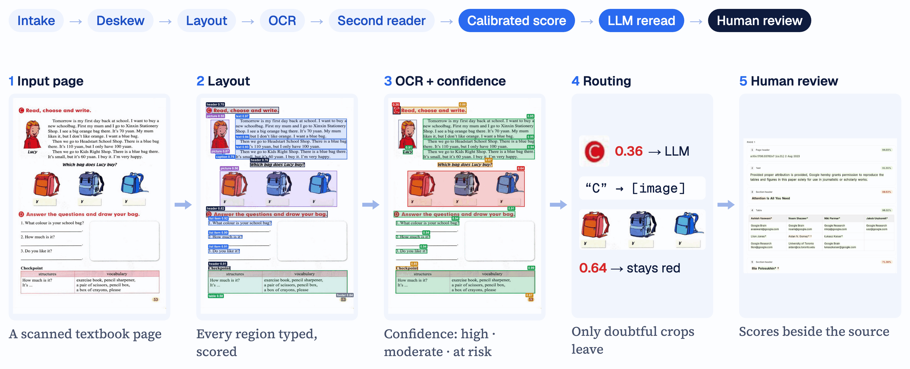
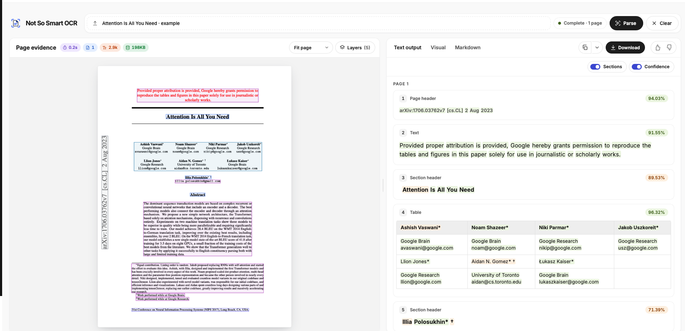

Every OCR makes mistakes. The dangerous ones are the mistakes it makes <em>confidently</em>.

<figure><video controls preload="none" playsinline width="1280" height="720" poster="../assets/media/notsosmartocr/film-poster.jpg" aria-label="The notSoSmartOCR film, 87 seconds with narration"><source src="../assets/media/notsosmartocr/film.mp4" type="video/mp4"></video><figcaption>The whole idea in 87 seconds. Sound on.</figcaption></figure>

Read the film's narration

Every OCR makes mistakes. notSoSmartOCR knows which ones, and gets them fixed.

First, LevelHead straightens the page from its Fourier spectrum, then four views vote on which way is up.

Heron sends three hundred queries across the page and keeps one box per region.

Checkboxes shrink to a few pixels when the page is squeezed for the detector, so a second pass reads overlapping tiles at full resolution, and finds them.

Then XY-cut splits the page at its widest gaps, so each column reads in order.

Falcon-OCR turns each region's pixels into text, one crop at a time.

Each score fuses two probabilities, Falcon's token confidence and Heron's layout confidence, through one calibration curve.

That number routes the region: keep it, glance at it, or flag it.

Flagged crops go to an LLM in one request, each tagged with an ID.

Answers come back by ID, and each is accepted or rejected on its own.

Gibberish becomes System Error.

On forms, the page becomes JSON, every value tied to the regions it came from.

Point it at a mountain of paper, and every page comes back read, scored, and ready to trust.

## The page that started it

Picture a page with a header printed sideways down its margin: SYSTEM ERROR.
A good OCR model looks at it and reads, with a perfectly straight face, **CYSTE M GRO**.
No warning, no hesitation.
Downstream, that string becomes a field in a database, a line in a summary, an answer to somebody's question.

I kept running into pages like that.
Faxes copied one time too many.
Phone photos taken at an angle.
Forms with checkboxes the size of a grain of rice.
Handwriting squeezed into the margins.
Every tool I tried gave me text.
None of them told me *which* parts of that text to trust.

So I set a different goal.
Not "read everything perfectly", because nothing does.
Instead:

> Read every region. Know how sure you are. Ask for help only where you're not.

## Why "not so smart"

The name is a promise.
notSoSmartOCR doesn't pretend to be clever.
It reads what it can, admits what it can't, and keeps every word tied to the exact spot on the page it came from, so you can always check its homework.

<figure><figcaption>One page, start to finish: find the regions, score them, reread the doubtful ones, and hand the rest to a person.</figcaption></figure>

## How a page travels

Here is the whole journey, without the math.

### 1. Turn it the right way up

Pages arrive sideways, upside down or slightly tilted, and every later step quietly assumes they don't.
Getting this boring step right mattered more than anything else I did.

It also turned into a research side quest.
[LevelHead](levelhead-film) straightens the page first and then lets a model vote on which way is up, and it works with any model, from a tiny classifier to a large vision-language model.
On the way I found a bug that made a popular open-source deskewer give up on phone photos; [the fix](https://github.com/phamquiluan/jdeskew/pull/30) is now merged upstream.

<figure><video class="loop" autoplay muted loop playsinline width="1000" height="408" poster="../assets/media/notsosmartocr/levelhead.jpg" aria-label="A page turned 121 degrees is levelled, scored in four quarter turns and voted upright"><source src="../assets/media/notsosmartocr/levelhead.mp4" type="video/mp4"></video><figcaption>Level first, then let four views vote on which way is up.</figcaption></figure>

### 2. Find the pieces

A layout model draws a box around every region (paragraphs, tables, headings, pictures, signatures) and names each one, so a table gets read as a table and a picture as a picture.

<figure><video class="loop" autoplay muted loop playsinline width="1000" height="408" poster="../assets/media/notsosmartocr/layout.jpg" aria-label="Regions found and named on a public textbook page, each with a score"><source src="../assets/media/notsosmartocr/layout.mp4" type="video/mp4"></video><figcaption>Every region found, named and scored.</figcaption></figure>

Tiny things hide.
A checkbox shrinks to a few pixels when the whole page is squeezed down for the detector.
So forms get a second look in overlapping tiles at full size, and suddenly the ticks appear.

<figure><video class="loop" autoplay muted loop playsinline width="1000" height="408" poster="../assets/media/notsosmartocr/checkboxes.jpg" aria-label="On a public form the first pass finds no checkboxes; the tiled pass finds four, ticked or empty"><source src="../assets/media/notsosmartocr/checkboxes.mp4" type="video/mp4"></video><figcaption>First pass: no checkboxes. Tiled pass: four, each ticked or empty.</figcaption></figure>

### 3. Read each piece, then score it

Each region is cut out and read on its own.
Then comes the part I care about most: every region gets a confidence, one number for how likely its text is right.
Green you keep, yellow deserves a glance, red needs help.

<figure><video class="loop" autoplay muted loop playsinline width="1000" height="408" poster="../assets/media/notsosmartocr/confidence.jpg" aria-label="Regions on a page turn green, yellow or red as they are scored"><source src="../assets/media/notsosmartocr/confidence.mp4" type="video/mp4"></video><figcaption>Green, yellow, red: the page tells you where to look.</figcaption></figure>

### 4. Ask for help only when unsure

Only the regions with a real reason for doubt go to a larger LLM for a second read.
All the doubtful crops travel together in one request, each tagged with an ID, and every answer comes back to exactly the region it belongs to.
Most of the page never leaves.
That is what keeps it cheap: on public benchmark pages, the second reads cost under 20 cents per thousand pages.

<figure><video class="loop" autoplay muted loop playsinline width="1000" height="408" poster="../assets/media/notsosmartocr/routing.jpg" aria-label="A stamp, two dates and two signatures are cut out, sent together and merged back by ID"><source src="../assets/media/notsosmartocr/routing.mp4" type="video/mp4"></video><figcaption>Cut out the doubtful bits, send them together, put every answer back where it came from.</figcaption></figure>

### 5. Let a person have the last word

Whatever is still uncertain waits in a review workbench.
Every line sits beside its source box with its confidence, and every edit is saved next to the original reading, so nothing is silently overwritten.

<figure><video class="loop" autoplay muted loop playsinline width="960" height="392" poster="../assets/media/notsosmartocr/review.jpg" aria-label="The review workbench with confidence per section, the linked source box and an inspector for editing"><source src="../assets/media/notsosmartocr/review.mp4" type="video/mp4"></video><figcaption>The review workbench: source on the left, output on the right, a person in charge.</figcaption></figure>

## Did it work?

::: stats

<b>88.2</b>overall on all 755 English pages of OmniDocBench, a public parsing benchmark

<b>¼ to ⅓</b>of regions get a second read; the rest are trusted as read

<b>&lt; 20¢</b>of LLM time per thousand pages

:::

Numbers are only part of the story.
The OmniDocBench score covers English pages only, so it isn't a like-for-like match with the full public leaderboard.
Handwriting, numbers in forms and reading order are still imperfect.
The screenshots in the repository show real output, errors included, because I'd rather show where it fails than hide it.

<figure><figcaption>The workbench on a real page.</figcaption></figure>

## What building it taught me

- **Confidence is a feature, not a metric.** A number that says "check this one" changes how people use the output far more than another point of accuracy.
- **The boring steps decide everything.** Turning pages upright sounded trivial. It broke more pages than any model choice, and fixing it properly became a research project of its own.
- **Small things hide.** Checkboxes, stamps and dates are where documents keep their most important answers, and where models look least.
- **Fix things upstream.** The deskewer bug cost me days; one merged pull request means it won't cost anyone else those days.
- **Show your work.** Keeping every word tied to its source made debugging easier for me and trust easier for everyone else.

## What's next

The goal hasn't changed since the first sideways header:

> Point it at a mountain of paper, and every page comes back read, scored, and ready to trust.

The code, the step-by-step walkthroughs and the film are on [GitHub](https://github.com/beingamanforever/notSoSmartOCR).
If you have a document it gets wrong, I'd love to see it.
