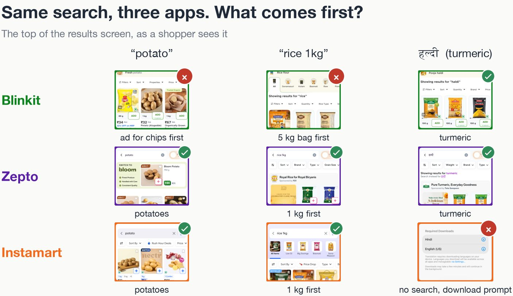
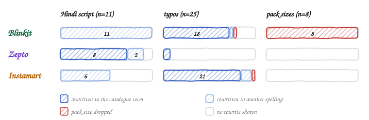

It started, like most bad decisions, with a post on X.
Someone noticed that Zomato's iOS app keeps eating memory the longer you scroll its home feed.
I replied with my own numbers (smaller spike, different phone, 43% battery, iOS 26.6.1), and then, instead of going to sleep like a normal person, I wired my iPhone to my Mac and spent the evening making three grocery apps search for turmeric.

This post is what came out of that evening.
First the negatives, then the positives, then my theory about the memory thing (which turned out to be half right), and finally some fixes nobody asked me for.

:::info
One phone, one account, one address in Bengaluru, one evening. Apps update every week, so treat this as a first look and not a verdict.
If you work on any of these apps: hi, please don't ban my account, I still need groceries.
:::

## The setup

Nothing fancy.
[WebDriverAgent](https://github.com/appium/WebDriverAgent) let the Mac tap, type and swipe on the phone, and [pymobiledevice3](https://github.com/doronz88/pymobiledevice3) read each app's memory, CPU and frame rate.
No app was modified; I used them exactly the way a customer does, through their own search boxes.

The idea is simple: `doodh` should find the same milk as `milk`.
So I took 25 everyday grocery searches and typed each one four ways: as is, with a typo, in Hindi script, and in Hinglish or with a pack size.
That's 375 searches across Blinkit, Zepto and Instamart, each with a saved screenshot of what came first.
If a rewritten search loses the product, something in the pipeline broke, and *which* rewrite broke it tells you *where*.

Every search engine, from Google to your kirana app, roughly does the same four things:

*The four stages of a search, and where each problem most likely lives. The animated query is Blinkit's handling of `rice 1kg`.*

Here's the first thing a shopper actually sees, for three of those searches:

## First, the negatives

### Search "potato", get chips

On 10 of 18 everyday staples (eggs, curd, tomato, potato, bread and friends), the first card on Blinkit is an ad.
Search `potato` and the first thing you see is a packet of Haldiram's chips.
Technically potato. Spiritually, not what I asked for.

*One square per staple search. Hatched means the first card was sponsored.*

The funny part: Blinkit shows the *fewest* ads of the three overall.
It just puts them first.
That looks less like greed and more like plumbing: my guess is that slot 1 is filled by a separate ad auction that never checks whether the ad belongs to the category you searched.
A potato-chips advertiser bids on "potato", wins, and nobody downstream asks whether a person typing "potato" at 9 pm wants to make aloo sabzi or eat their feelings.

### "rice 1kg" becomes "rice"

Ask Blinkit for `rice 1kg` and its banner says *Showing results for "rice"*.
The first card is a 5 kg bag, in all four ways I phrased it (`rice 1kg`, `rice 1 kg`, `1000g rice`, you get the idea).
Instamart keeps your words but still shows a 2 kg pack first when you ask for 5 kg of atta.
Zepto got the size right 8 times out of 8.

My guess is a spelling-correction step that sees `1kg` as noise and helpfully deletes it.
It's the search equivalent of a waiter who hears "one masala dosa, less oil" and writes down "dosa".

### हल्दी, and a download prompt

This one is my favourite.
Type हल्दी (turmeric) into Instamart and iOS pops up a sheet saying *Required Downloads: Hindi, English*.
No search runs.
Close the sheet, wait, retry: nothing.
That happened on 10 of my 11 Hindi-script searches.

*The path from हल्दी to a product on each app, read off each app's own "Showing results for" line.*

The irony: on 3 November, a week before my test, Swiggy [announced](https://x.com/WeAreSwiggy/status/2117089326228287750) LLM-powered search for Instamart that "reads Hindi, Hinglish, Kannada and Telugu".
I believe them.
The server probably can.
The phone just never asks it, because the app seems to route Hindi-script queries through Apple's on-device Translation feature first, which needs language packs, which most people have never downloaded.[^1]

Blinkit and Zepto both found turmeric every time, but they take very different roads.
Blinkit spells हल्दी out in Latin letters (`haldi`) and then hopes its Hinglish word list knows the word.
Zepto jumps straight to the catalogue name, `turmeric`.
Both work for turmeric; Blinkit's road just has one more place to fall off.
You can see the difference in what each app *says* it searched for:

*Counts per app and query type, from each app's "Showing results for" banner. Blinkit drops the size on all 8 pack-size searches.*

### Silence, for screen readers

I turned on VoiceOver and searched `milk`.

> **Blinkit:** *(silence)*. Zero of the 14 items on the results screen say anything.
>
> **Instamart:** "Nandini Shubham Milk, 500 ml, MRP ₹32, 6% off, final price ₹30."

None of the product names or prices on Blinkit's results screen reach the phone's accessibility layer.
On its home screen, the only element labelled "Search" opens the separate Bistro app.
This matters beyond blind shoppers too: the AI shopping assistants everyone is building read the same accessibility layer, so they're equally stuck.

## Then, the positives

In fairness, a lot works.
All three apps were fast, and none of them *ever* returned an empty page, across all 375 searches.
Zepto nailed every pack size and read Hindi script the clean way.
Instamart never put an ad in slot 1 and reads every card out in full.
Blinkit found the right product for all 11 Hindi-script searches, even if it took the scenic route.

## The memory thing (a.k.a. why I started)

Back to the post that started this.
I opened each app fresh and scrolled its home feed for five minutes, recording memory and smoothness, with the phone cooling down between apps.

*One run each on an iPhone 16. Zomato scrolled by hand (memory reading ended at 3.6 min), Blinkit by script.*

| | Zomato | Blinkit |
|---|---|---|
| Memory while scrolling | 176 MB, past 413 MB, still climbing | 161 MB, up to 338 MB, then flat |
| Smoothness | ~31 frames per second | ~54 frames per second |
| Data downloaded in 5 min | 131 MB | 9 MB |

Before anyone screenshots this and writes "Blinkit good, Zomato bad": Blinkit's line goes flat because its home feed *ends* after about 75 seconds.
There's nothing new to load, so of course memory stops growing.
In my earlier runs, both apps kept climbing.
Zomato's feed is endless, so its line just keeps going.
Flat versus climbing, on its own, proves nothing about a leak.

### My first theory: it's the clicks

Here's what I believed going in.
Every recommendation engine runs on behaviour: what you tapped, how long you lingered, how far you scrolled.
Those events form a time series, a sequence, and that sequence is exactly what neural networks are good at learning from.
So the app has to store your clicks and scrolls somewhere to optimise what it shows you next.
If it never throws the old ones away, that's an eviction problem.
Blinkit's feed is short, so it barely matters there; Zomato's is endless, hence the explosion.

It's a clean story.
So I did the thing you should always do with a clean story: arithmetic.

### The arithmetic

An analytics event is a small JSON blob: an event name, an item id, a timestamp, some context.
Call it 0.5 to 1 KB.
Even if you log a very generous 10 events a second for 5 minutes and *never* send any of them, that's 3,000 events, about 3 MB.
Zomato grew by 237 MB.

*Back of the envelope. The click log is the sliver at the top.*

And real apps don't hoard events anyway.
Segment's iOS SDK, a typical example, sends a batch [every 20 events or every 30 seconds](https://www.twilio.com/docs/segment/connections/sources/catalog/libraries/mobile/ios) and caps its queue at 1,000 events.
The sequence that trains the recommender lives on a server, not in your phone's RAM (more on that in a bit).

Images, on the other hand, are enormous once decoded.
A JPEG is compressed; to draw it, iOS unpacks it into raw pixels at **width × height × 4 bytes**, and that buffer lives as long as the image does.
Apple's own [WWDC18 talk](https://developer.apple.com/videos/play/wwdc2018/219/) uses the example of a 590 KB photo that needs about 12 MB once decoded.
A full-width card image on an iPhone 16 is roughly 1179 × 660 pixels: about 3 MB of pixels each.
237 MB is about 76 of those.
Zomato's restaurant cards each carry their own swipeable carousel, and the app pulled down 131 MB in five minutes, which is mostly images.
Seventy-six decoded images after three and a half minutes of scrolling is not a stretch.

So my eviction instinct was right.
I just blamed the wrong tenant.
The thing not getting evicted is most likely decoded images (and the views holding them), not the click log.

*Left: every image you scroll past stays decoded in memory until iOS kills the app. Right: a least-recently-used cap keeps the last few screens and drops the oldest.*

Two more things fit this story.
Memory rose in *steps*, each matching a burst of CPU as a new batch of cards loaded.
And Zomato felt heavy in a way that memory alone doesn't explain: scripted swipes took about 12 seconds to register, against under a second on Blinkit, which smells like carousels and videos still animating off screen and hogging the main thread.

### Has this happened before? Constantly.

Once you go looking, "memory climbs while scrolling a feed of pictures" is one of the most re-discovered bugs in mobile development:

- **Facebook built a whole library because of it.** In 2015 they released [Fresco](https://engineering.fb.com/2015/03/26/android/introducing-fresco-a-new-image-library-for-android) for Android, largely to stop image-heavy feeds from crashing with out-of-memory errors. Its key trick: the moment an image view goes off screen, it releases the image.
- **SDWebImage, the most popular iOS image loader, has the issue on repeat.** In [#1544](https://github.com/SDWebImage/SDWebImage/issues/1544) (2016), memory climbs while scrolling a collection view of ~500 KB images; the advice is to cap `maxMemoryCost`. In [#271](https://github.com/SDWebImage/SDWebImageSwiftUI/issues/271) of its SwiftUI port (2023), memory "will keep growing while scrolling the image list".
- **Android got there too.** Picasso [#1685](https://github.com/square/picasso/issues/1685) is a RecyclerView crashing with OOM while scrolling, though that one turned out to be an 11 MB error placeholder.[^2]
- **Meta automated the hunt.** In 2016 they wrote about [automatic memory leak detection on iOS](https://engineering.fb.com/2016/04/13/ios/automatic-memory-leak-detection-on-ios), because retain cycles in view controllers kept sneaking into their apps.

And to be fair to my original theory, unbounded event queues are real too.
Segment's Java library had [an issue](https://github.com/segmentio/analytics-java/issues/161) asking for a maximum queue size precisely because its queues were unbounded and could run out of memory under heavy traffic.
That's a server under load, though, not a phone browsing biryani.
On a phone, the image cache is the much bigger suspect.

### How to actually confirm it

I can't see inside Zomato, so everything above is an informed guess.
Here's the test that would settle it: scroll down a fixed number of cards and back to the top, four times, on both apps, with the same script.

*Expected shapes, not measurements. I haven't run the matched test yet.*

If memory falls back each time you return to the top, it's a cache that's too big.
If it keeps stepping up, something is never released, and that's a leak.
Zomato's own engineers can go one better with Instruments: if the growth sits in image buffers, it's images; if it sits in dictionaries of strings, my click theory gets its revenge.

## Where the time series actually lives

The part of my theory that *was* right: modern recommenders really are sequence models over your behaviour.
The big players are just very deliberate about where that sequence is stored.

*The phone is a sensor. It queues a few events, ships them in batches, and forgets them. The sequence lives server-side.*

- **Pinterest** ranks its home feed with [TransAct](https://arxiv.org/abs/2306.00248) (KDD 2023): a transformer over your *real-time* actions, combined with user embeddings computed offline in batch. Their [TransAct V2](https://medium.com/pinterest-engineering/next-level-personalization-how-16k-lifelong-user-actions-supercharge-pinterests-recommendations-bd5989f8f5d3) goes up to 16,000+ lifelong actions per user, each stored as a compact token (timestamp, action type, surface, a quantised 32-number item embedding), and for each candidate pin it only pulls the most recent actions plus the ones most similar to that pin.
- **Alibaba** published the [Behavior Sequence Transformer](https://arxiv.org/abs/1905.06874) for Taobao back in 2019: feed the sequence of items a user clicked into a transformer, predict the next click.
- **Meta** went all in with [HSTU](https://arxiv.org/abs/2402.17152) (ICML 2024), treating user actions as their own "language" and training generative recommenders with up to 1.5 trillion parameters over sequences of thousands of actions. It reported a 12.4% lift in online A/B tests.

Notice what none of them do: keep that sequence in the app's memory.
Your phone holds a few kilobytes of queued events.
The terabytes live in a feature store next to the model.

### What this could look like for quick commerce

Grocery is almost unfairly well suited to sequences, because it's so repetitive.
If I were building it, each token would be something like *(what I typed, what I tapped, what I added, the time, what's already in my cart)*, and a few things fall out almost for free:

- **Hindi script, fixed from logs.** If people type हल्दी and then tap Tata Sampann turmeric, that pair *is* the mapping. No Hinglish detour needed.
- **Pack sizes that remember you.** If I've bought 1 kg rice the last six times, rank 1 kg first even when I type just `rice`.
- **Relevance gates for ads.** A session that goes `onion → tomato → potato` is cooking. Maybe don't open with chips.
- **Basket completion.** Maggi in the cart at 11 pm has a well-known next item, and it isn't a salad.

And if you really do want some of this on the device (for offline use, or for privacy), keep it in a ring buffer: the last few hundred events, oldest out first.
That's my original eviction idea, applied to the thing it actually fits.

## What I'd fix

Most of this is cheap.

| App | Stage | Fix | How to check |
|---|---|---|---|
| Instamart | Understanding | Send the text as typed to the server; never wait on a language download. | Hindi-script searches return results with no packs installed. |
| Blinkit | Ranking and ads | Keep slot 1 for a matching product on staples, or allow only same-category ads there. | A/B test on add-to-cart for the top card. |
| Blinkit | Understanding | Read `1kg`, `1 kg` and `1000g` as a size before spell-correcting, and rank by it. | The banner keeps the size; that size comes first. |
| Blinkit | Expansion | Map Hindi script straight to catalogue names; keep Hinglish as a synonym. | Grow the map from what people typed and then tapped. |
| Blinkit | On screen | Give every product card a spoken label; label the real search bar "Search". | Apple's accessibility audit in UI tests. |
| Zomato | Home feed | If the matched test confirms it: recycle cards, cap and downscale images, pause off-screen carousels and video. | Memory falls back after scrolling to the top. |

## Caveats

One phone, one account, one address, one evening.
The memory comparison is a single run per app with different scroll methods, and my numbers came out lower than the original post's, which says as much about phones and battery levels as about apps.
Next up: food search on Zomato and Swiggy, and the matched memory test, so I can find out whether this post ages well or becomes the thing I chuckle at in five years.[^3]

[^1]: My guess, from the outside. The prompt is iOS's own Translation sheet, and it only appears for Hindi-script input, which is about as strong a hint as you get without the source code.

[^2]: Jake Wharton's reply, roughly: "This is not a Picasso problem." Every library maintainer has typed that sentence at least a thousand times.

[^3]: Knowing my track record, both.
